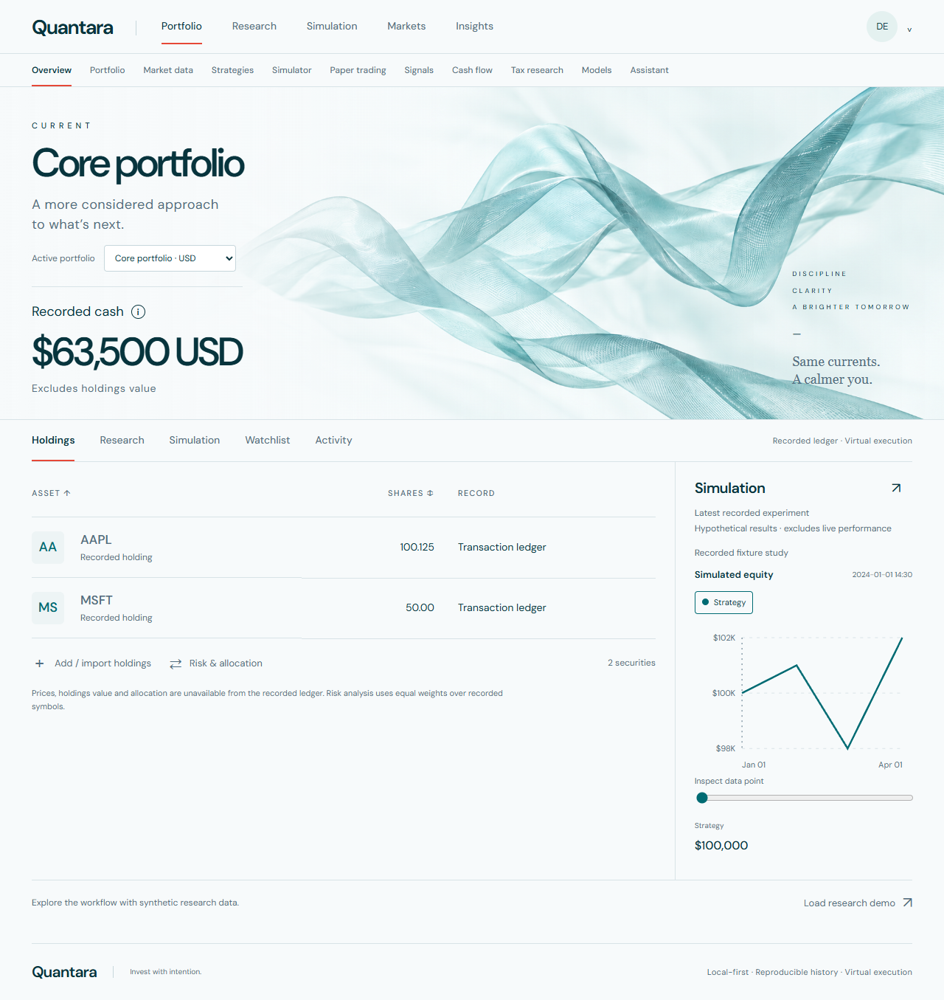

# Quantara

[](https://github.com/achitaan/Quantara/actions/workflows/ci.yml)

Quantara is a local research workspace for portfolio accounting, strategy simulation, and explanations grounded in saved results and documents. Import transactions and market history, test an idea, inspect the trades and assumptions, then ask the assistant about the evidence.

I am developing it to learn quantitative finance, machine learning, and full-stack engineering. The aim is to make the mechanics understandable and testable. A model that runs is only the beginning of evaluating whether it is useful.



_The Current interface, shown with a synthetic test portfolio and a fixture-based simulation. The balances, holdings, and results are demonstration data, not a real account or evidence of trading performance._

Current brings the eleven research tools into one horizontal navigation, with an aqua fabric header, petrol typography, coral accents, and light and dark themes. The overview keeps the active portfolio's recorded cash and currency, fractional holdings, latest simulation, watchlist, and activity together. It also provides links into the wider research workflow. The fabric hero stays in place as the holdings section scrolls over it; reduced-motion settings use normal page scrolling.

The portfolio overview is a transaction ledger. It does not supply live prices, holdings market values, daily changes, or market-value allocations. Portfolio risk research uses equal weights over recorded symbols, rather than weights inferred from share counts.

## Run locally

Use **Python 3.12** and **Node.js 22**, the versions used in CI. The core app does not require Ollama or the optional neural-model packages. Dependency installation needs internet access; the synthetic demo can be explored without a market-data provider.

### First run on Windows

Run these commands from the repository root:

```powershell
py -3.12 -m venv .venv
.\.venv\Scripts\python.exe -m pip install -r backend\requirements.txt
.\.venv\Scripts\python.exe scripts\setup_local.py
.\.venv\Scripts\python.exe -m uvicorn app:app --app-dir backend --host 127.0.0.1 --port 8000
```

Leave the API running. In a second terminal, also starting at the repository root:

```powershell
cd frontend
npm ci
$env:BACKEND_URL = "http://127.0.0.1:8000"
npm run dev -- --port 3100
```

Open [http://127.0.0.1:3100](http://127.0.0.1:3100). Sign in with `TEAM_USERNAME` and `TEAM_PASSWORD` from the **root `.env`** file. The generated username defaults to `demo`. Copy only the password value, without the surrounding quotes; the browser does not prefill it. The setup script reports that credentials were saved and does not print them. Keep this ignored file private.

Select **Load research demo** in Overview to create labeled synthetic history, then inspect the holdings or open Simulator. For your own records, start in Portfolio and Market data; the [data conventions](docs/DATA_CONVENTIONS.md) describe CSV columns, timestamps, currencies, and defaults. API documentation is available at [http://127.0.0.1:8000/docs](http://127.0.0.1:8000/docs).

### Restarting and recovering setup

On later runs, start the API and frontend with the same commands. You do not need to regenerate credentials. `setup_local.py` refuses to replace a configured login and reports `Configuration exists`. If that is your existing installation, continue with its `.env` credentials.

To intentionally replace the native login password, run this from the repository root and restart the API:

```powershell
.\.venv\Scripts\python.exe scripts\setup_local.py --rotate-login
```

Rotation revokes existing sessions, so sign in again with the new value. It does not change the password of an already initialized PostgreSQL role; that requires a separate database password change.

Local databases, downloaded weights, and checkpoints live under the ignored `runtime/` directory. Native SQLite and local jobs support one API process. Use PostgreSQL and Celery when running multiple processes.

On Linux/macOS, create the environment with `python3.12 -m venv .venv`, use `.venv/bin/python` for the Python commands, and start the frontend with `BACKEND_URL=http://127.0.0.1:8000 npm run dev -- --port 3100`.

## What you can research

| Tool                     | What it does                                                                                                                                                                                                                                                                                         |
| ------------------------ | ---------------------------------------------------------------------------------------------------------------------------------------------------------------------------------------------------------------------------------------------------------------------------------------------------- |
| Portfolio                | Saves accounts, transactions, cash, holdings, and settings; validates CSV imports. Risk tools include equal weight, maximum Sharpe, minimum volatility, risk parity, Black–Litterman, and CVaR allocations, plus VaR, expected shortfall, drawdown, benchmark-factor exposure, and stress scenarios. |
| Market data              | Imports daily, one-minute, and five-minute history with exchange-calendar checks, corporate actions, and provenance. Supports Yahoo history and optional Alpaca feeds.                                                                                                                               |
| Strategies and Simulator | Defines trading rules and runs historical simulations with next-bar execution, market/limit orders, costs, partial fills, chronological partitions, benchmarks, and trade exports. Walk-forward evaluation uses a fixed policy, without retraining per fold.                                         |
| Paper trading            | Runs virtual accounts through historical replay or forward bar polling, with saved orders and fills, duplicate protection, restart recovery, and stale-feed indicators. Native mode uses the Poll action; the container scheduler polls completed provider bars.                                     |
| Signals                  | Imports timestamped news and social records, replays information available at each decision time, and evaluates news impact chronologically. Optional local DistilBERT provides sentiment scores.                                                                                                    |
| Cash flow                | Records recurring payments and compares baseline, Prophet, and LSTM forecasts on chronological holdouts.                                                                                                                                                                                             |
| Tax research             | Calculates pooled CAD adjusted cost base using transaction-date FX and account types; flags provisional superficial-loss cases and produces harvesting proposals and CSV exports.                                                                                                                    |
| Models                   | Trains seeded PPO/DDPG policies in a Gymnasium environment, records learning curves and checkpoint provenance, and compares held-out results with buy-and-hold, SMA, momentum, and a benchmark.                                                                                                      |
| Assistant                | Uses local Qwen and validated analytical tools to explain saved evidence. Supports streamed responses, saved conversations, document excerpts, retrieval, and page citations.                                                                                                                        |

Overview connects these tools through Holdings, Research, Simulation, Watchlist, and Activity views. Simulation and training charts support series toggles, drawdown views, and pointer or keyboard inspection. Training rewards and held-out returns are shown separately. Older checkpoints must be retrained to record learning curves that were not saved originally.

## Add local AI and research models

### Qwen through Ollama

The default is **Ollama with `qwen3.5:4b`**. Calculations and simulations remain available if the language model is offline. Local mode rejects cloud model tags and nonlocal Ollama hosts and has no automatic hosted fallback.

From the repository root on Windows:

```powershell
.\scripts\setup_ollama.ps1
.\scripts\serve_ollama.ps1
```

Leave the service running and pull the model in another terminal:

```powershell
.\runtime\ollama\0.35.0\ollama.exe pull qwen3.5:4b
```

The setup script downloads the pinned official Ollama release and checks its published SHA-256 before extracting it. The service script binds to localhost and disables cloud features. Alternatively, use an installed Ollama service with `OLLAMA_NO_CLOUD=1`, then run `ollama serve` and `ollama pull qwen3.5:4b`.

| Root `.env` setting | Default                                  | Purpose                                   |
| ------------------- | ---------------------------------------- | ----------------------------------------- |
| `LLM_PROVIDER`      | `ollama`                                 | Inference provider                        |
| `LLM_MODEL`         | `qwen3.5:4b`                             | Model tag                                 |
| `OLLAMA_URL`        | `http://127.0.0.1:11434`                 | Backend connection to Ollama              |
| `LLM_MAX_TOKENS`    | `600`                                    | Maximum generated response length         |
| `LLM_KEEP_ALIVE`    | `30m`                                    | Requested model residency after inference |
| `EMBEDDING_MODEL`   | `sentence-transformers/all-MiniLM-L6-v2` | Document encoder                          |

The bundled service uses an 8,192-token context and one parallel inference request. Latency depends on hardware, prompt size, and whether the model is already loaded. The [assistant report](docs/VISUALIZATION_AND_ASSISTANT.md) records measurements from a specific local machine; they are not performance guarantees.

Hosted inference is an explicit configuration choice: `LLM_PROVIDER=hosted`, an HTTPS `HOSTED_LLM_URL`, `HOSTED_LLM_KEY`, and a configured model. Python services still perform numerical calculations.

### Optional models and document embeddings

PPO/DDPG, DistilBERT, Prophet, LSTM, and local embedding/FAISS retrieval need the optional dependencies. From the repository root:

```powershell
.\.venv\Scripts\python.exe -m pip install torch==2.8.0 --index-url https://download.pytorch.org/whl/cpu
.\.venv\Scripts\python.exe -m pip install -r backend\requirements-models.txt
$env:HF_HOME = Join-Path (Get-Location) "runtime/huggingface"
.\.venv\Scripts\python.exe scripts\cache_embedding_model.py
```

Cache the embedding weights once with internet access. Retrieval then loads the cached encoder offline on CPU. Other optional models may download weights on first use. Import documents in Assistant and build the local index. Text search works before indexing; stale or incompatible indexes prompt a rebuild.

## Containers and team configuration

Generate the root `.env` with `scripts/setup_local.py` before starting Docker Compose. Reuse existing credentials if setup has already been completed.

```sh
docker compose up --build
```

Compose defines PostgreSQL, Redis, the API, Celery worker and scheduler, and the frontend at [http://127.0.0.1:3000](http://127.0.0.1:3000). Named volumes preserve database and runtime data. Stop the stack with `docker compose down`; avoid `--volumes` unless you intend to delete that data.

To include Ollama, use the AI profile instead, then pull the model from another terminal:

```sh
docker compose --profile ai up --build
docker compose exec ollama ollama pull qwen3.5:4b
```

Set `INSTALL_MODELS=true` in the root `.env` before rebuilding to include optional model dependencies. Initialize embedding weights in the shared runtime volume before indexing:

```sh
docker compose exec api python -c "from quantara.config import settings; from sentence_transformers import SentenceTransformer; SentenceTransformer(settings.embedding_model, device='cpu')"
```

For a team environment, configure `DEMO_MODE=false`, `TEAM_USERNAME`, `TEAM_PASSWORD`, and a private `POSTGRES_PASSWORD`. The native `scripts/team_user.py` command creates additional logins interactively in the configured database. Passwords are hashed, sessions use HttpOnly cookies, and API requests enforce ownership and origin checks.

For HTTPS deployment, set `COOKIE_SECURE=true` and the intended `ALLOWED_ORIGINS` in the API environment. The supplied Compose file fixes the allowed origins to local port 3000 and does not forward `COOKIE_SECURE` from `.env`; update its API environment mapping for deployment.

CI validates the Compose configuration, but full Compose/Redis/Celery startup remains an acceptance check for the intended environment. Native checks do not establish container deployment readiness.

## Verify a change

The core checks mirror [CI](.github/workflows/ci.yml). From the repository root, with the native dependencies installed:

```powershell
.\.venv\Scripts\python.exe -m pytest
.\.venv\Scripts\python.exe -m ruff check backend\quantara backend\tests scripts
.\.venv\Scripts\python.exe scripts\export_openapi.py
cd frontend
npm run types
npm run typecheck
npm run build
npm run test:e2e
```

Browser tests start their own API and production frontend on ports **8101/3101**, using an isolated database and test credential. Those ports must be free; build the frontend first. Windows uses installed Edge by default. Set `BROWSER_CHANNEL` to use another installed Chromium-based browser. Linux CI installs Chromium with `npx playwright install --with-deps chromium`; a local Linux run also needs that browser installed. The test API deliberately points Ollama at an unavailable port to check model-outage usability. Real Qwen behavior is measured separately.

To check optional models after installing their dependencies and caching weights, start a new terminal at the repository root:

```powershell
$env:QUANTARA_MODEL_TESTS = "1"
$env:HF_HOME = Join-Path (Get-Location) "runtime/huggingface"
.\.venv\Scripts\python.exe -m pytest backend\tests\test_optional_models.py backend\tests\test_lightweight_models.py backend\tests\test_research_accuracy.py
cd frontend
npm run test:e2e
```

`QUANTARA_MODEL_TESTS=1` also enables the policy-training browser workflow. `TEST_POSTGRES_URL` enables the PostgreSQL integration check. CI runs core, PostgreSQL, and browser checks separately from the optional model job, which caches embeddings before offline retrieval tests.

For an application walkthrough, leave the native API running and use another terminal at the repository root:

```powershell
.\.venv\Scripts\python.exe scripts\demo.py --url http://127.0.0.1:8000
# Add forecasts, seeded training, and checkpoint backtests:
.\.venv\Scripts\python.exe scripts\demo.py --url http://127.0.0.1:8000 --include-models
# With Qwen running and its configured model installed:
.\.venv\Scripts\python.exe scripts\benchmark_ai.py --url http://127.0.0.1:8000
```

These scripts read the configured login from `.env` and create synthetic demo records in that account. The benchmark records tools, citations, latency, and residency under `runtime/`. Use a research account if you want to keep those records separate from your own imports.

The [verification history](docs/VERIFICATION.md), [simulation and training audit](docs/RESEARCH_ACCURACY.md), and [visualization and assistant report](docs/VISUALIZATION_AND_ASSISTANT.md) retain the evidence and scope of previous runs. Their test counts and timings describe those runs, not a fresh result for every revision.

## Engineering choices and limits

One accounting and execution engine serves historical backtests, paper replay, and the RL environment. This lets cash, holdings, fees, splits, dividends, and rewards be checked together. Training records include seeds, requested and actual steps, execution costs, data fingerprints, package versions, and checkpoint checksums.

Evaluation separates training, validation, and test history and enforces next-bar fills. The research audit checks that changing held-out observations does not change fitted parameters. Comparisons include simple baselines, and saved results retain cases where a neural model underperforms them. Short synthetic runs demonstrate evaluation mechanics; they do not establish predictive accuracy or trading outperformance.

The assistant keeps calculations in Python, validates analytical tool arguments, and retrieves document passages with citation checks. Explanations still need to be compared with the cited evidence; valid citation identifiers alone do not prove that every statement is correct.

The remaining boundaries matter when interpreting a result:

- **All orders are virtual.** Real brokerage execution and public onboarding are outside the current scope.
- **Fills are bar-based assumptions.** The simulator models costs and volume participation, but not order-book queues or market impact. Settlement delays and dividend withholding are not modeled; supplied dividend event dates determine credit timing. See the [audit](docs/RESEARCH_ACCURACY.md) for the exact execution rules.
- **Tax outputs are research calculations.** Missing affiliated records, unfinished future windows, and complex overlapping transactions remain provisional or require review. The tool does not produce a tax filing.
- **Reproducibility has an environment boundary.** Seeded results are checked on the tested runtime, without a promise of bit-identical results across hardware or library versions.
- **Provider and deployment acceptance is incomplete.** Live-provider behavior, prolonged forward-feed recovery, and the full container stack need checks in the environment where they will run. Plaid support is Sandbox-only.

## Code and documentation

| Path                | Responsibility                                                                                        |
| ------------------- | ----------------------------------------------------------------------------------------------------- |
| `frontend/`         | Next.js, React, and TypeScript interface; interactive charts, typed API client, and browser workflows |
| `backend/quantara/` | FastAPI services for accounting, analytics, simulation, retrieval, and model research                 |
| `backend/tests/`    | Numerical, accounting, API, ownership, recovery, and model-evaluation checks                          |
| `scripts/`          | Setup, demonstrations, audits, generated API contracts, and benchmarks                                |
| `docs/`             | Data conventions, implementation status, and recorded verification                                    |
| `legacy/`           | Preserved prototypes, excluded from the supported runtime                                             |

SQLite supports native development; PostgreSQL supports the configured container environment. Background work uses local executors or Redis/Celery with saved job IDs, polling/SSE progress, retry, and cancellation. Optional research models are separate from the Qwen language model.

Use [data conventions](docs/DATA_CONVENTIONS.md) when preparing imports, [implementation status](docs/IMPLEMENTATION.md) when checking feature scope, and the linked audits when interpreting research results. The generated [OpenAPI contract](docs/openapi.json) and frontend API types are checked together in CI to catch drift between the API and its client.
